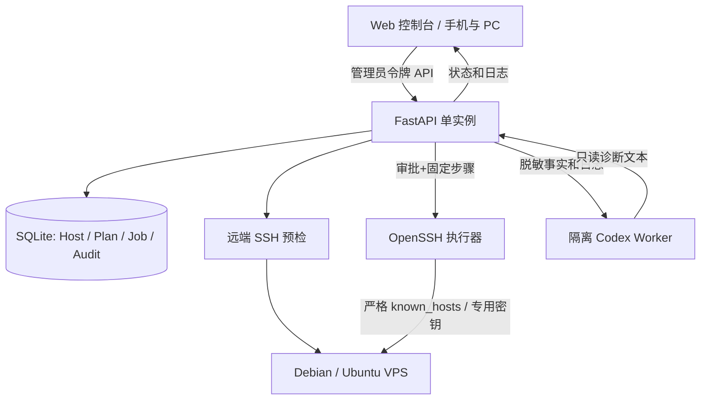
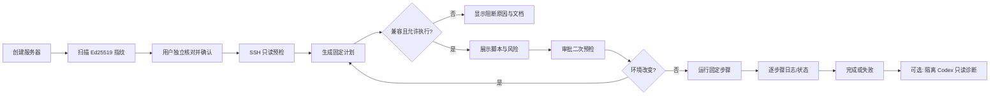

# NetDeploy AI · 第一阶段架构（VPS 优先）

## 目标

用户通过 Web 面板选择 VPS 和项目，系统执行 **可审计的确定性步骤**，Codex 在隔离环境中只读解释日志与提出修复建议。开发原则为可控、可回放、可验证，而不是给予大模型 unrestricted root shell。

## 数据流

## 技术栈

- **前端**：原生 HTML / CSS / JavaScript，响应式，Zero runtime third-party CDN；以后可迁 Vue 3。
- **API**：Python 3.12 / FastAPI / Pydantic。
- **执行器**：OpenSSH (`-F /dev/null -o StrictHostKeyChecking=yes -o BatchMode=yes -i <fixed key>`)；`bash -se` 接收内部审核脚本的 stdin。
- **队列**：第一阶段为单 Uvicorn Worker 的线程级执行队列 + SQLite 状态。服务器重启后不重放未完成任务，而是标记 `interrupted` 并要求核对远端。
- **数据库**：SQLite + WAL 可以后续引入；现阶段序列化写入、读取连接短生命周期，适合单管理员、轻负载原型。
- **AI**：Codex Python SDK（隔离 Worker，默认可关闭）；只有环境与脱敏日志，不获取数据库、SSH 私钥、管理员令牌和 Docker Socket。
- **Skills**：每个项目目录 `SKILL.md`，告诉模型如何解释运行条件和输出建议；执行许可严格来源于 `app/catalog.py` 的内置白名单。
- **包装**：Docker Compose，默认只绑定宿主机 `127.0.0.1:8787`。

## 第一阶段对象模型

- `hosts`: `{id,name,hostname,port,username,auth_mode,facts,checked_at}`；不保存 SSH 密码或私钥。
- `projects`: 审核的四个项目及安装类型 `install` / `guided`。
- `plans`: 固定步骤、风险和先决条件，作为 `jobs.plan_json` 快照保存。
- `jobs`: `{id,host_id,project,status,plan,created_at,approved_at,logs,error}`。
- `known_hosts`: 主机公钥固定记录；必须独立核对 SHA256 指纹才可加入。

## 工作流与状态机

状态：`planned → queued → running → completed/failed`，以及重启时的 `interrupted`。**completed** 仅表示执行脚本按预期退出，不证明全部网络功能已配置妥当。

## 四个模板的现实差异

- **sing-box**：官方签名 APT 仓库，可执行「安装内核」步骤；配置生成、TLS 和节点连接留待下一阶段。初期不自动开启服务或暴露端口。
- **wg-easy**：要求现有 Docker Compose，使用 v15 主版本镜像，容器 UDP 51820 对外，Web 管理仅监听 VPS 本地 51821；首次配置通过 SSH 隧道安全访问。
- **3X-UI**：官方存在互动式脚本/host 网络 Docker 方式，风险较高；v0.1 仅提供条件核验和参考文档；后续使用经过核验的固定版本交付。
- **Hysteria2**：官方安装脚本仅提供示例配置，用户需指定认证及 TLS 证书；v0.1 仅引导，后续做完整安全配置向导。

## 不包含在 Alpha 中

多租户/权限管理、无 SSH root 账号安装、数字证书托管、全自动回滚、实时 WebSocket 日志、任意操作系统兼容、远端服务管理、受信发布签名、异地任务调度。正式公网 SaaS 版本需要逐项实现后才能开放。
